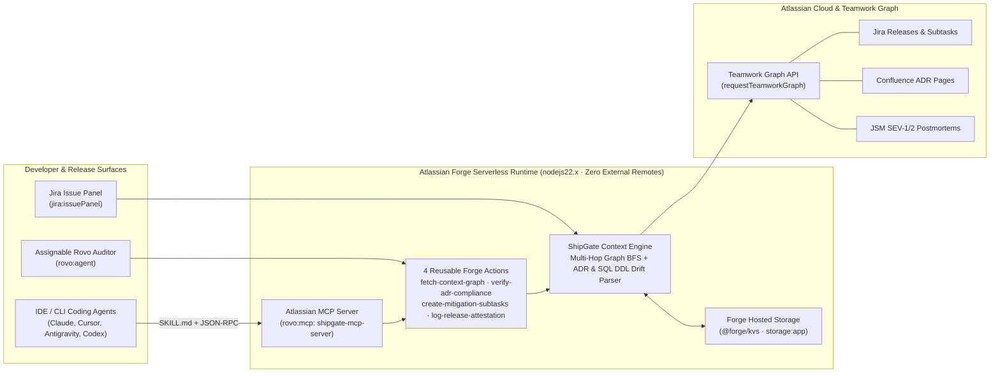

# ShipGate Context

> **Know every hidden decision, dependency, and past incident before you merge or deploy — inside Jira, Rovo, and right inside your coding agent via Atlassian MCP.**

[](LICENSE)
[](forge-app/manifest.yml)
[-10B981)](forge-app/manifest.yml)
[](https://jalnanco.github.io/shipgate-context/)

Built for **Codegeist 2026: Build with context. Ship with confidence.**
- **Interactive Judge's Web Sandbox (Zero-Login Instant Preview)**: **https://jalnanco.github.io/shipgate-context/**
- **Main Category**: **Apps for Software Teams**
- **Targeted Bonus Prizes**:
  1. **Best Agents - Rovo/Assignable agents** (`rovo:agent` + 4 reusable `action` modules)
  2. **Best app with Atlassian MCP** (`rovo:mcp` server + portable [`SKILL.md`](SKILL.md) for Claude Code, Cursor, Antigravity & Codex)
  3. **Best apps with Teamwork Graph integration** (`requestTeamworkGraph` multi-hop blast-radius traversal + graph attestation lineage)
  4. **Runs on Atlassian / Marketplace Ready** (100% Forge Hosted Compute & `@forge/kvs` Storage, `0` external remotes)

---

## Why ShipGate Context Exists

Production outages rarely happen because code failed to compile—they happen because **organizational context got lost across silos**:
- Six months ago, an approved Confluence **Architecture Decision Record (`ADR-014`)** capped synchronous checkout PSP timeouts at `<= 3000ms` after a 43-minute Black Friday thread-pool collapse (**`INC-402`**).
- Today, an engineer—or an AI coding agent—opens a holiday readiness ticket (**`PAY-482`**) raising `checkout.payment.timeout = 15s` with **zero explicit Jira links** to `ADR-014` or `INC-402`.

**ShipGate Context** turns Atlassian's **Teamwork Graph**, **Confluence ADRs**, **Jira Service Management (JSM) postmortems**, and **Compass component ownership** into a quantitative **Ship Confidence Score (`0–100`)** inside Jira, Rovo, and external coding agents via **Atlassian MCP**.

---

## System Architecture (`Runs on Atlassian`)



---

## Repository Structure

| Path | Description |
| :--- | :--- |
| [`forge-app/manifest.yml`](forge-app/manifest.yml) | Official Forge manifest validated with `@forge/manifest` `FullValidationProcessor` (`0 errors`): `jira:issuePanel`, `jira:adminPage`, `rovo:agent`, `action` (×4), and `rovo:mcp`. |
| [`forge-app/src/contextEngine.ts`](forge-app/src/contextEngine.ts) | Multi-hop Teamwork Graph traversal, human-duration/percentage normalizer, PostgreSQL `CONCURRENTLY` lock parser, and deterministic Ship Confidence Score (`0–100`) engine. |
| [`forge-app/src/teamworkGraphClient.ts`](forge-app/src/teamworkGraphClient.ts) | Live `@forge/api` `requestTeamworkGraph`, Jira REST v3, Confluence REST v2, and `@forge/kvs` storage adapters. |
| [`forge-app/src/seeder.ts`](forge-app/src/seeder.ts) | **1-Click Judge's Demo Workspace Seeder** (`PAY-482`, `AUTH-319`, `DATA-704`, `OBS-910`, 4 ADRs, 3 SEV-1/2 JSM incidents). |
| [`forge-app/tests/shipgate.test.ts`](forge-app/tests/shipgate.test.ts) | Automated manifest & engine test suite (`8/8 PASS`). |
| [`SKILL.md`](SKILL.md) & [`mcp-configs/`](mcp-configs/) | Portable open-source skill and MCP client configurations for Claude Code, Cursor, Google Antigravity, and Codex CLI. |
| [`web/`](web/) & [`docs/`](docs/) | Interactive browser sandbox sharing the exact TypeScript `contextEngine.ts` core, hosted on GitHub Pages. |

---

## Quick Verification & Deployment Guide for Judges

### Option A — Instant Browser Sandbox (0 Setup)
Open **https://jalnanco.github.io/shipgate-context/** and click **`⚡ Seed Realistic Demo Workspace (1-Click)`**:
1. Inspect **`PAY-482`** (`Confidence Score: 45/100 · BLOCKED`) showing both **`ADR-014`** timeout drift and the **unlinked 2-hop `INC-402` SEV-1 postmortem**.
2. Click **`✨ Apply ADR-Compliant Fix`** (`2800ms`) → **`Create Jira Mitigation Subtasks`** → **`Log Release Attestation`** to watch the graph edges turn green (`100/100 · SHIP READY`).
3. Switch tabs to test the **Assignable Rovo Release Auditor** (`rovo:agent`) and **Atlassian MCP Live JSON-RPC Console** (`rovo:mcp`).

### Option B — Local Automated Verification (`8/8 PASS`)
```bash
cd forge-app
npm install
npm run check
```
Runs TypeScript compilation (`tsc`), official `@forge/manifest` `FullValidationProcessor` (`success=true, errors=0`), and the unit/integration test suite (`8/8 PASS`).

### Option C — Deploy to an Atlassian Cloud Developer Site
```bash
cd forge-app
npm install
forge register
forge deploy -e production
forge install --upgrade
```
After installing on your Jira & Confluence Cloud site, open **Jira Settings → Apps → ShipGate Demo Workspace Seeder** and click **`Seed Realistic Demo Workspace (1-Click)`**.

---

## License

Released under the [MIT License](LICENSE).
